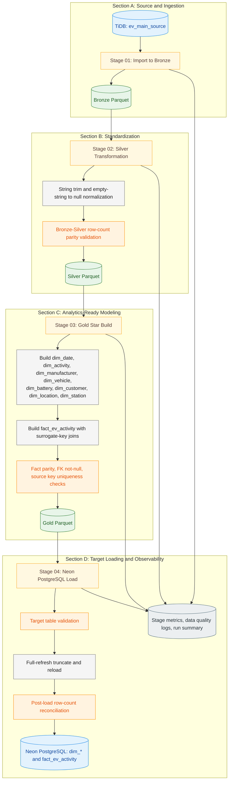
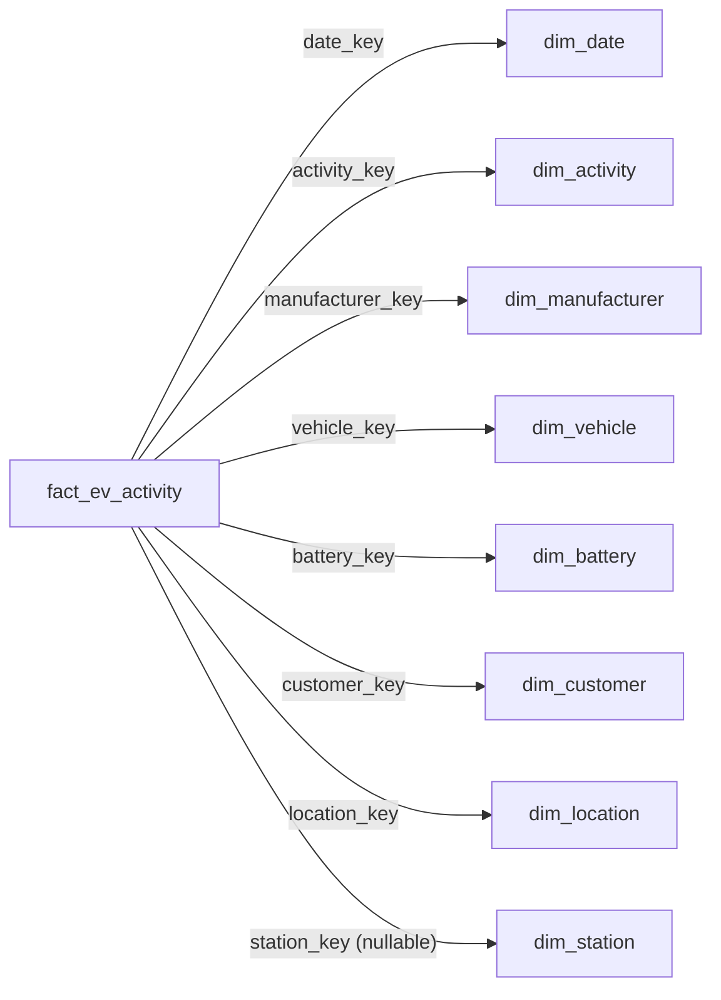

# EV Star Schema Medallion ETL Pipeline

**A Python ETL pipeline that transforms one wide EV operational source table from TiDB into an analytics-ready star schema in Neon PostgreSQL using Bronze-Silver-Gold layers.**

[](https://www.python.org/)
[](https://pandas.pydata.org/)
[](https://docs.sqlalchemy.org/)
[](#architecture-and-data-flow)
[](EV_Star_ETL_Pipeline/logs/evs_20261005T084850Z_1829678a_run_summary.json)

> This project transforms mixed EV operational attributes into a dimensional analytics model designed for reporting, KPI analysis, and BI consumption.

Recorded run snapshot: status success, stages: 4, checks: 15 passed and 0 failed.

**At a Glance**

| Attribute | Information |
|---|---|
| Business purpose | EV analytics enablement through dimensional modeling |
| Source database | TiDB |
| Target database | Neon PostgreSQL |
| Source table | `ev_main_source` |
| Target model | Star schema (`fact_ev_activity` + `dim_*`) |
| Processing architecture | Bronze-Silver-Gold |
| ETL implementation | Python scripts |
| Quality controls | Source load, parity, FK integrity, uniqueness, post-load reconciliation |
| Recorded execution | 10,000 source rows transformed; 52,821 model rows loaded |
| Orchestration | Python pipeline runner |

### Table of Contents

1. [Overview](#overview)
2. [Verified Execution Results](#verified-execution-results)
3. [Architecture and Data Flow](#architecture-and-data-flow)
4. [Pipeline Stages](#pipeline-stages)
5. [Data Model](#data-model)
6. [Data Quality and Reliability](#data-quality-and-reliability)
7. [Technology Stack](#technology-stack)
8. [Project Structure](#project-structure)
9. [Setup and Execution](#setup-and-execution)
10. [Current Gaps and Next Improvements](#current-gaps-and-next-improvements)
11. [License](#license)

## Overview

The pipeline reads one operational EV source table from TiDB, writes Bronze and Silver Parquet layers, builds Gold dimension and fact datasets, and loads the final star schema into Neon PostgreSQL.

Execution is orchestrated by [EV_Star_ETL_Pipeline/scripts/run_pipeline.py](EV_Star_ETL_Pipeline/scripts/run_pipeline.py), with shared configuration and reliability helpers in [EV_Star_ETL_Pipeline/scripts/ev_common.py](EV_Star_ETL_Pipeline/scripts/ev_common.py).

## Verified Execution Results

**Recorded run ID:** `evs_20261005T084850Z_1829678a`

| Metric | Value |
|---|---:|
| Pipeline status | success |
| Total stages | 4 |
| Checks passed | 15 |
| Checks failed | 0 |
| Source rows extracted (Bronze) | 10,000 |
| Fact rows generated | 10,000 |
| Total rows loaded to Neon (dims + fact) | 52,821 |

### Stage Durations

| Stage | Duration |
|---|---:|
| `01_import_to_bronze` | 2.605 seconds |
| `02_silver` | 0.362 seconds |
| `03_gold` | 0.478 seconds |
| `04_load_neon` | 42.043 seconds |
| **Total (sum of recorded stage durations)** | **45.488 seconds** |

These figures represent one recorded execution and should not be treated as a performance benchmark or SLA.

What these metrics show:
- The four-stage pipeline completed successfully in sequence.
- Quality checks covered extraction, transformation integrity, and target load reconciliation.
- The verified run reflects an operational snapshot, not a guarantee of future runtime or throughput.

Evidence:
- [EV_Star_ETL_Pipeline/logs/evs_20261005T084850Z_1829678a_run_summary.json](EV_Star_ETL_Pipeline/logs/evs_20261005T084850Z_1829678a_run_summary.json)
- [EV_Star_ETL_Pipeline/logs/evs_20261005T084850Z_1829678a_data_quality_checks.jsonl](EV_Star_ETL_Pipeline/logs/evs_20261005T084850Z_1829678a_data_quality_checks.jsonl)

## Architecture and Data Flow



Flow summary: TiDB -> Bronze -> Silver -> Gold -> Neon PostgreSQL.

## Pipeline Stages

### Stage 01 - Import to Bronze

- **Script:** [EV_Star_ETL_Pipeline/scripts/01_import_to_bronze.py](EV_Star_ETL_Pipeline/scripts/01_import_to_bronze.py)
- **Input:** source table `ev_main_source` in TiDB.
- **Processing:** extracts all source rows and writes one Bronze Parquet dataset.
- **Output:** `EV_Star_ETL_Pipeline/parquet/bronze/ev_main_source.parquet`.
- **Quality checks:** source table loaded check.

### Stage 02 - Silver Transformation

- **Script:** [EV_Star_ETL_Pipeline/scripts/02_silver.py](EV_Star_ETL_Pipeline/scripts/02_silver.py)
- **Input:** Bronze source dataset.
- **Processing:** trims text fields and converts empty strings to null.
- **Output:** `EV_Star_ETL_Pipeline/parquet/silver/ev_main_source.parquet`.
- **Quality checks:** Bronze-to-Silver row-count parity.

### Stage 03 - Gold Modeling

- **Script:** [EV_Star_ETL_Pipeline/scripts/03_gold.py](EV_Star_ETL_Pipeline/scripts/03_gold.py)
- **Input:** Silver source dataset.
- **Processing:**
    - builds 8 dimensions (`dim_date`, `dim_activity`, `dim_manufacturer`, `dim_vehicle`, `dim_battery`, `dim_customer`, `dim_location`, `dim_station`)
    - builds `fact_ev_activity` with surrogate-key joins and source lineage (`source_record_id`)
- **Output:** `EV_Star_ETL_Pipeline/parquet/gold/dim_*.parquet` and `EV_Star_ETL_Pipeline/parquet/gold/fact_ev_activity.parquet`.
- **Quality checks:**
    - source vs fact row parity
    - required foreign keys not null
    - `source_record_id` uniqueness

### Stage 04 - Neon PostgreSQL Load

- **Script:** [EV_Star_ETL_Pipeline/scripts/04_load_neon.py](EV_Star_ETL_Pipeline/scripts/04_load_neon.py)
- **Input:** Gold dimension and fact datasets.
- **Processing:**
    - validates target tables
    - truncates fact and dimensions with restart identity cascade
    - loads dimensions first, then fact
    - verifies post-load row counts per table
- **Output:** populated target tables in Neon PostgreSQL schema.
- **Quality checks:** table existence and post-load reconciliation for all target tables.

Load behavior note:
- The current implementation is full refresh for non-empty Gold outputs (truncate and append).
- If interruption occurs between truncate and complete reload, consumers may see temporary partial availability until recovery.

### Orchestration

- **Script:** [EV_Star_ETL_Pipeline/scripts/run_pipeline.py](EV_Star_ETL_Pipeline/scripts/run_pipeline.py)
- **Supported options:** `--from-stage` and `--to-stage` with values 01 to 04.
- **Behavior:** executes selected stage range sequentially and writes a run summary from stage metrics.

## Data Model

Source table:
- `ev_main_source`

Target model:
- Fact table: `fact_ev_activity`
- Dimension tables: `dim_date`, `dim_activity`, `dim_manufacturer`, `dim_vehicle`, `dim_battery`, `dim_customer`, `dim_location`, `dim_station`

| Model component | Table | Purpose |
|---|---|---|
| Fact | `fact_ev_activity` | Records EV activity at the documented fact grain |
| Dimension | `dim_date` | Date-related analytical attributes |
| Dimension | `dim_activity` | Activity classification |
| Dimension | `dim_manufacturer` | Manufacturer attributes |
| Dimension | `dim_vehicle` | Vehicle attributes |
| Dimension | `dim_battery` | Battery attributes |
| Dimension | `dim_customer` | Customer attributes |
| Dimension | `dim_location` | Location attributes |
| Dimension | `dim_station` | Charging-station attributes |

Fact grain:
- One row per source `record_id`.

Key modeling notes:
- `source_record_id` preserves source lineage in the fact.
- Surrogate keys are generated for dimension joins.
- `station_key` can be null for non-charging events.



## Data Quality and Reliability

### Data Quality Controls

| Check | Pipeline Stage | Purpose |
|---|---|---|
| Source table loaded | Bronze | Validate successful extraction |
| Row-count parity | Silver | Detect unexpected count differences |
| Fact row parity | Gold | Ensure no row loss from source to fact |
| Required FK not null | Gold | Protect dimensional integrity |
| Source key uniqueness | Gold | Detect duplicate lineage keys |
| Target table existence | Load | Verify destination readiness |
| Post-load reconciliation | Load | Verify expected vs actual row counts |

### Operational Reliability

- Database retry behavior is implemented via `run_with_retries` in [EV_Star_ETL_Pipeline/scripts/ev_common.py](EV_Star_ETL_Pipeline/scripts/ev_common.py).
- Strict-mode behavior is configurable through `EVSF_STRICT_MODE` for quality check failure handling.
- Run-specific observability is captured as stage metrics, data quality checks, and run summary artifacts.

## Technology Stack

| Category | Technology | Purpose |
|---|---|---|
| Language | Python | ETL implementation and orchestration |
| Data processing | Pandas | Transformations and dimensional modeling |
| Database abstraction | SQLAlchemy | Source and target connectivity abstraction |
| Source driver | PyMySQL | TiDB access |
| Target driver | psycopg2 | PostgreSQL access |
| Intermediate storage | Parquet / PyArrow | Bronze, Silver, Gold datasets |
| Configuration | python-dotenv | Environment variable loading |

Dependencies: [requirements.txt](requirements.txt)

## Project Structure

```text
EV_ETL_Project/
├── README.md
├── BUSINESS_PROBLEM.md
├── BUSINESS_REQUIREMENTS.md
├── DATA_REQUIREMENTS.md
├── Business_Story.md
├── POWER_BI_TECHNIQUES_PLAYBOOK.md
├── requirements.txt
├── EV_Star_ETL_Pipeline/
│   ├── logs/
│   ├── parquet/
│   │   ├── bronze/
│   │   ├── silver/
│   │   └── gold/
│   └── scripts/
│       ├── ev_common.py
│       ├── 01_import_to_bronze.py
│       ├── 02_silver.py
│       ├── 03_gold.py
│       ├── 04_load_neon.py
│       └── run_pipeline.py
└── EV_TargetDB_Analytics_App/
    ├── app/
    ├── reports/
    ├── scripts/
    └── requirements.txt
```

## Setup and Execution

### 1) Install dependencies

```powershell
pip install -r .\requirements.txt
```

Optional (if you want to activate the local virtual environment first):

```powershell
.\myenv\Scripts\Activate.ps1
```

### 2) Configure environment variables

Set values in root `.env` for source and target databases.

Required source keys:
- `TIDB_HOST`
- `TIDB_PORT`
- `TIDB_USERNAME` or `TIDB_USER`
- `TIDB_PASSWORD`
- `TIDB_DATABASE`

Required target keys:
- `NEON_DSN` (or host/db/user/password alternatives supported by code)
- `TARGET_SCHEMA`

### 3) Run full ETL

```powershell
.\myenv\Scripts\python.exe .\EV_Star_ETL_Pipeline\scripts\run_pipeline.py
```

### 4) Run partial ETL

```powershell
.\myenv\Scripts\python.exe .\EV_Star_ETL_Pipeline\scripts\run_pipeline.py --from-stage 02 --to-stage 04
```

Partial-range note:
- Running from an intermediate stage requires valid upstream artifacts to already exist in the corresponding Parquet layer.

Load-safety note:
- Stage 04 uses full-refresh loading (truncate then append). If interruption occurs during load, consumers may temporarily see incomplete target data until recovery completes.

## Current Gaps and Next Improvements

| Area | Current Status | Recommended Improvement |
|---|---|---|
| Automated schema, join, and regression tests | Not documented as automated in repository evidence | Add automated validation suites for schema contracts, join integrity, and KPI regression checks |
| Load safety and failure recovery | Full-refresh truncate-and-reload can expose temporary incompleteness on interruption | Add safer cutover pattern, recovery playbooks, and load-guard controls |
| Incremental loading / CDC | Not implemented; current strategy is full refresh | Introduce incremental partitioned loads or CDC where source constraints allow |
| Scheduling, alerting, and operations monitoring | Script-driven execution; no scheduler or alerting documented | Integrate scheduler and alerting with operational monitoring dashboards |
| Schema migration and versioning | No explicit schema migration/versioning framework documented | Introduce migration/versioning practices for controlled schema evolution |

## License

This project is intended for portfolio and educational use.

No formal license file (for example, `LICENSE`) is present in this repository as of this README update.
